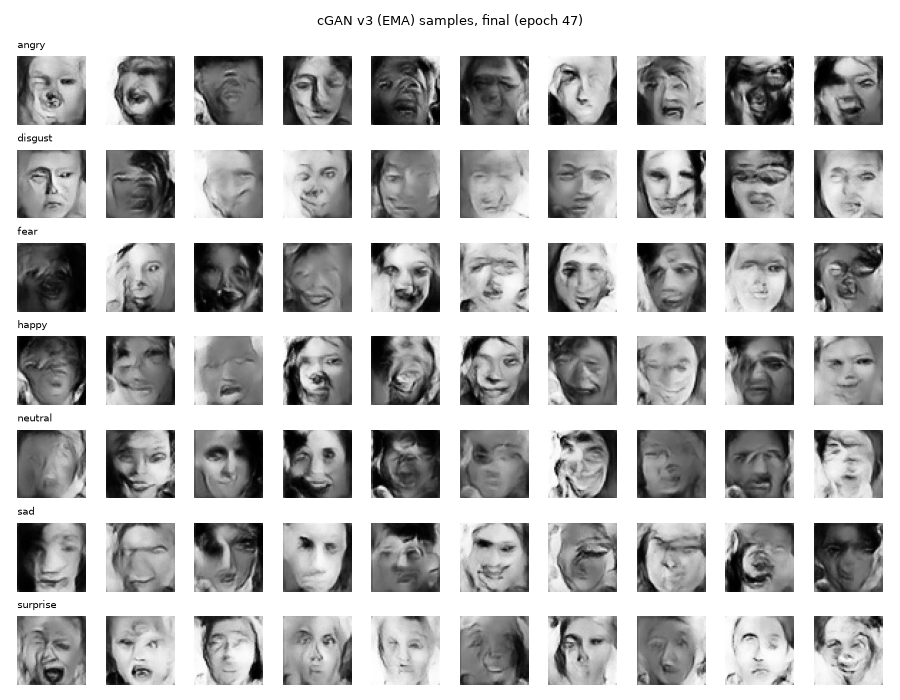
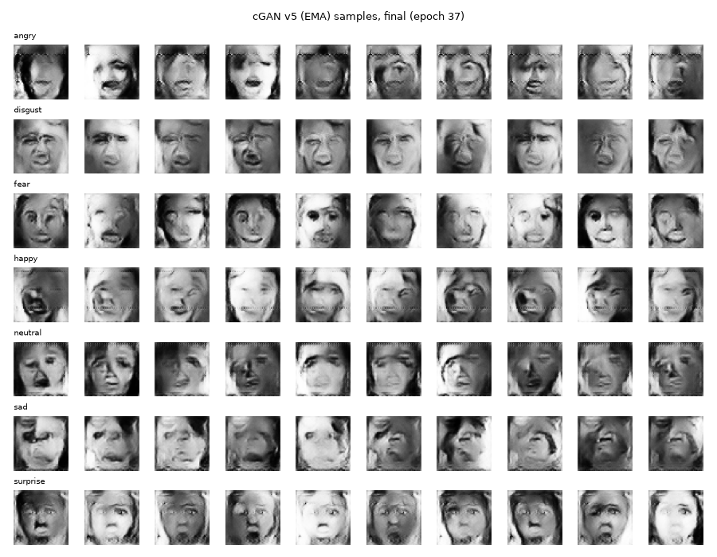
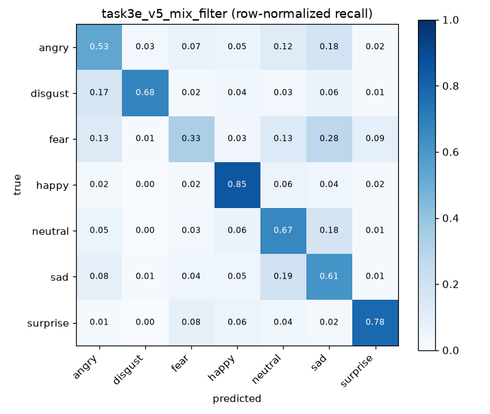

# FER2013 情緒分類：原始資料 vs 影像增強 vs GAN 生成資料（Keras）

課程作業「訓練情緒分類器」的完整程式、實驗紀錄與心得。資料集為 Kaggle 上的
[FER2013](https://www.kaggle.com/datasets/msambare/fer2013)（48×48 灰階人臉，7 種情緒）。

作業要求三個任務：

1. 用原始資料、不處理，直接訓練一個情緒分類模型
2. 用影像增強讓各類別數量比較平均，再訓練一個情緒分類模型
3. 訓練一個 GAN，用它生成資料後，再訓練一個情緒分類模型

這份報告分兩輪。第一輪做完三個任務後，GAN 的結果比「不處理」還差；第二輪我接著問
「GAN 是不是能做得更好？」，分別從**用法**（怎麼用生成圖）和**品質**（把 GAN 本身訓練得更好）兩條路試，
並把失敗的嘗試一起記錄下來。

## 結果總覽

所有分類器使用**完全相同**的 CNN、超參數、隨機種子、驗證集與測試集。各實驗之間只有「訓練集內容」不同
（3f 例外：訓練集與任務 2 相同，但起始權重是先用 GAN 圖預訓練過的）。
測試集（7,178 張，從未參與訓練或挑模型）上的結果：

| 實驗 | 訓練集內容 | 測試準確率 | 測試 macro-F1 | 換種子重跑的 macro-F1 |
|---|---|---|---|---|
| 任務 1：原始資料 | 24,403 張真圖 | 64.04% | 0.603 | 0.6005（種子 1） |
| **任務 2：影像增強平衡** | 真圖 + 18,528 張增強圖（每類 6,133） | **65.20%** | **0.631** | 0.6298（種子 1） |
| 任務 3a：GAN v1 全補 | 真圖 + 18,528 張 GAN v1 圖（disgust 崩塌） | 60.82% | 0.562 | — |
| 任務 3b：GAN v2 全補 | 真圖 + 18,528 張 GAN v2 圖（修正崩塌） | 62.26% | 0.586 | — |
| 任務 3c：GAN v2 篩選 + 補一半 | 真圖 + 經篩選的 GAN v2 圖（缺額一半）+ 增強圖 | 62.89% | 0.597 | — |
| 任務 3e：GAN v5 篩選 + 補一半 | 真圖 + 經篩選的 GAN v5 圖（缺額一半）+ 增強圖 | 64.99% | 0.626 | 0.6302（種子 1） |
| 任務 3f：GAN v2 預訓練 + 任務 2 微調 | 先只用 42,931 張 GAN v2 圖預訓練，再用任務 2 的訓練集微調 | 64.56% | 0.626 | — |

（3d 原本留給「GAN v3 的分類器」，因 v3 未通過 6.1 節的品質門檻而沒有做，見 6.3 節。）七個類別的完整召回率見
[`results/summary.md`](results/summary.md)，每個實驗的詳細指標見 `results/<實驗>/metrics.json`。


一句話結論：**影像增強平衡（任務 2）仍是最好的做法，macro-F1 從 0.603 提升到 0.631。GAN 生成圖若用對方法
（先篩選、只補一半缺額，或只拿來預訓練），能追到和影像增強打平（3e 兩個種子平均 0.628，任務 2 平均 0.631），但沒有超越；
直接把全部缺額用 GAN 圖補滿則會比不處理還差（0.562、0.586）。**

---

## 1. 環境與重現方式

| 項目 | 版本 |
|---|---|
| 硬體 | Apple M5（Keras 透過 PyTorch 後端使用 Apple GPU / MPS） |
| Python | 3.12 |
| Keras | 3.15.1（後端 `torch` 2.14.1） |
| 其他 | numpy、scikit-learn、scipy、matplotlib、pillow，見 `requirements.txt` |

```bash
uv venv .venv --python 3.12
uv pip install --python .venv/bin/python -r requirements.txt

# 下載資料（需要 Kaggle API 帳號；資料不放在本倉庫）
kaggle datasets download -d msambare/fer2013 -p data/raw
unzip -q data/raw/fer2013.zip -d data/extracted

export KERAS_BACKEND=torch

# 第一輪
.venv/bin/python task1_baseline.py                 # 任務 1（加 --seed 1 即為換種子重跑）
.venv/bin/python task2_augment.py                  # 任務 2（同樣可加 --seed 1）
.venv/bin/python task3_gan.py                      # GAN v1（一般抽樣，70 分鐘）
.venv/bin/python task3_gan.py --balanced           # GAN v2（各類別均衡抽樣，70 分鐘）
.venv/bin/python task3_classifier.py --generator task3_generator.keras    --task-name task3_gan_classifier_v1   # 3a
.venv/bin/python task3_classifier.py --generator task3_generator_v2.keras --task-name task3_gan_classifier_v2   # 3b

# 第二輪：改「用法」
.venv/bin/python task3_classifier.py --generator task3_generator_v2.keras --task-name task3c_v2_mix_filter \
    --gan-fraction 0.5 --filter-model task2_augment.keras                                                     # 3c
.venv/bin/python task3_pretrain.py                 # 3f：GAN v2 圖預訓練 + 任務 2 微調

# 第二輪：改「品質」（生成器架構不變，只改訓練方式與判別器）
.venv/bin/python task3_gan_v3.py                                                              # GAN v3（150 分鐘）
.venv/bin/python task3_gan_v3.py --clean-aux --time-limit-min 90                              # GAN v4（第 5 epoch 未達門檻，停止）
.venv/bin/python task3_gan_v3.py --clean-aux --aux-weight 1.0 --tag v5 --time-limit-min 90    # GAN v5
.venv/bin/python task3_classifier.py --generator task3_generator_v5.keras --task-name task3e_v5_mix_filter \
    --gan-fraction 0.5 --filter-model task2_augment.keras                                                     # 3e
.venv/bin/python task3_classifier.py --generator task3_generator_v5.keras --task-name task3e_v5_mix_filter_seed1 \
    --gan-fraction 0.5 --filter-model task2_augment.keras --seed 1                                            # 3e 換種子

# GAN 品質檢查與彙整
.venv/bin/python analyze_gan_fid.py --generators v1=task3_generator.keras v2=task3_generator_v2.keras \
    v3=task3_generator_v3.keras v5=task3_generator_v5.keras                                   # FER-FID
.venv/bin/python analyze_gan_memorization.py --generators v1=task3_generator.keras v2=task3_generator_v2.keras \
    v3=task3_generator_v3.keras v5=task3_generator_v5.keras                                   # 是否在「背圖」
.venv/bin/python analyze_gan_agreement.py --generators v1=task3_generator.keras v2=task3_generator_v2.keras \
    v3=task3_generator_v3.keras v5=task3_generator_v5.keras                                   # 標籤一致率（未篩選）
.venv/bin/python make_summary.py                   # 產生比較表與比較圖
```

下載的 `fer2013.zip` SHA-256 為
`9f3422c7a45b676c2965ef4fc5f3099932aa98fd13eaaa2c254f620a9894a6e9`，可用來確認拿到的是同一份資料。

| 檔案 | 用途 |
|---|---|
| `common.py` | 共用：讀資料、切驗證集、CNN 架構、訓練與評估（含可指定起始權重）、畫圖 |
| `task1_baseline.py` | 任務 1（`--seed` 可換訓練種子） |
| `task2_augment.py` | 任務 2：影像增強過採樣（`--seed`） |
| `task3_gan.py` | 任務 3：條件式 DCGAN（cGAN）v1/v2 訓練（`--balanced` 切換 v2） |
| `task3_gan_v3.py` | 任務 3 第二輪：cGAN v3/v4/v5（`--clean-aux`、`--aux-weight`、`--tag`、`--time-limit-min`） |
| `task3_classifier.py` | 用 GAN 補資料後訓練分類器；`--gan-fraction` 控制缺額中 GAN 圖的比例、`--filter-model` 篩選生成圖、`--seed` |
| `task3_pretrain.py` | 3f：只用 GAN 圖預訓練 CNN（同時算 CAS），再用任務 2 的資料微調 |
| `analyze_gan_fid.py` | 各版 GAN 的 FER-FID（用任務 1 CNN 的特徵算 Fréchet distance） |
| `analyze_gan_memorization.py` | 檢查生成圖是否只是複製訓練圖 |
| `analyze_gan_agreement.py` | 各版 GAN 的標籤一致率與多樣性（每版每類 1,000 張未篩選生成圖，任務 1 分類器判讀） |
| `make_summary.py` | 彙整所有實驗，輸出 `results/summary.md` 與 `results/comparison_recall.png` |
| `results/` | 每個實驗的指標 JSON、學習曲線、混淆矩陣、GAN 樣本圖；`results/_failed/` 是失敗嘗試與診斷紀錄 |
| `logs/` | 每次訓練的完整輸出 |

## 2. 資料與實驗設計

### 2.1 資料分布（非常不平均）

Kaggle 這個版本只有 `train/`（28,709 張）與 `test/`（7,178 張）。我從 `train/` 依類別比例、
固定種子（42）分層抽出 15% 當**驗證集**，其餘當訓練集（`results/data_split_counts.json`）：

| | angry | disgust | fear | happy | neutral | sad | surprise | 合計 |
|---|---|---|---|---|---|---|---|---|
| 訓練 | 3,396 | **371** | 3,482 | **6,133** | 4,220 | 4,106 | 2,695 | 24,403 |
| 驗證 | 599 | 65 | 615 | 1,082 | 745 | 724 | 476 | 4,306 |
| 測試 | 958 | 111 | 1,024 | 1,774 | 1,233 | 1,247 | 831 | 7,178 |

happy 和 disgust 差了 16.5 倍。這是任務 2、3 想解決的問題。

### 2.2 讓比較公平的規則

這些規則是在寫模型程式**之前**就決定好的：

- **同一個 CNN**：VGG 風格，4 個卷積區塊（32→64→128→256 個濾鏡，每塊兩層 3×3 卷積 + BatchNorm + ReLU，
  接 MaxPool 與 Dropout 0.25），再接 GlobalAveragePooling、Dense(256)、Dropout 0.5、softmax(7)。共 1,242,151 個參數。
- **同一組訓練設定**：Adam lr=1e-3、batch 128、最多 50 epochs；驗證損失 3 個 epoch 沒進步就把學習率減半，
  8 個 epoch 沒進步就提早停止，並還原驗證損失最低時的權重；隨機種子固定為 42。
- **驗證集與測試集永遠只有真實影像**：不做增強、不放生成圖。先切好驗證集，才對訓練集做平衡，
  避免同一張照片的增強版本同時出現在訓練與驗證集。
- **測試集只在最後評估一次**：挑 epoch 只看驗證集。
- **不只看準確率**：資料不平衡時，模型全猜 happy 也有 25% 準確率，所以同時報告 **macro-F1**
  （七類 F1 的平均，每類權重相同）、各類別召回率與混淆矩陣。
- **補資料的目標一致**：任務 2 與任務 3 的所有變化都把每一類補到 6,133 張（happy 的張數），訓練集都是 42,931 張。

### 2.3 換種子重跑：多大的差異才算數？

每個設定主要只跑一次，所以我把任務 1、任務 2 與第二輪最好的 GAN 實驗（3e）各用另一個訓練種子（1）重跑。
資料切分與補進來的資料都不變，只改變模型初始權重、dropout 與打亂順序
（`results/task1_raw_seed1/`、`results/task2_augment_seed1/`、`results/task3e_v5_mix_filter_seed1/`）：

| | 種子 42 | 種子 1 | 差距 |
|---|---|---|---|
| 任務 1 macro-F1 | 0.6027 | 0.6005 | 0.002 |
| 任務 2 macro-F1 | 0.6314 | 0.6298 | 0.002 |
| 任務 3e macro-F1 | 0.6259 | 0.6302 | 0.004 |
| 任務 1 sad 召回率 | 0.631 | 0.528 | **0.10** |
| 任務 2 disgust 召回率 | 0.712 | 0.504 | **0.21** |

- **macro-F1 很穩定**：換種子只差 0.002～0.004。所以 0.03 的差距是真的，0.005 以內的差距只能說「差不多」。
- **單一類別的召回率非常不穩定**：disgust 只有 111 張測試圖，換個種子就差 0.21。
  因此本報告的結論都以 macro-F1 為準，各類別召回率只當作參考。

## 3. 任務 1：原始資料直接訓練

**步驟**

1. 讀入 48×48 灰階 JPG，轉成 uint8 陣列。
2. 唯一的處理是把像素除以 255 縮放到 [0, 1]，這是神經網路輸入必要的格式轉換。
   不做影像增強、不重新取樣、不加 class weight。
3. 用上述 CNN 與訓練設定訓練。

**結果**：測試準確率 **64.04%**，macro-F1 **0.603**（第 20 個 epoch 最佳，第 28 個 epoch 提早停止；
`results/task1_raw/metrics.json`）。


- 訓練準確率持續上升到約 79%，驗證準確率停在 62% 左右：**模型開始過擬合**，提早停止有發揮作用。
- **fear 最難**（召回率 0.23）：1,024 張 fear 測試圖中，322 張被判成 sad、202 張被判成 surprise，只有 233 張判對。
  這幾類表情本來就相似（張嘴、皺眉），FER2013 人工標註的一致率也不高。
- disgust 只有 371 張訓練圖，召回率 0.55，比預期好，但這個類別只有 111 張測試圖，數字的不確定性很大（見 2.3 節）。

## 4. 任務 2：影像增強讓資料平均後訓練

**步驟**

1. 目標：每個類別都補到和最多的類別（happy，6,133 張）一樣多。訓練集從 24,403 張變成 42,931 張。
2. 原始影像全部保留不動。每類不足的張數，從該類原圖中隨機挑一張（可重複挑），套上隨機增強後當作新圖。
   disgust 從 371 張補到 6,133 張，平均每張原圖會產生約 15 個變形版本。
3. 增強用 Keras 的前處理層（`keras.layers.Random*`），刻意選擇**不會改變表情意義**的溫和變換：
   - `RandomFlip("horizontal")`：左右翻轉（表情左右翻轉後意義不變；上下翻轉就不合理，所以不用）
   - `RandomRotation(0.04)`：約 ±15° 旋轉
   - `RandomTranslation(0.08)`、`RandomZoom(±10%)`：模擬不同的人臉裁切位置與大小
   - `RandomContrast(0.2)`、`RandomBrightness(0.15)`：模擬不同光線
4. 用平衡後的訓練集，以和任務 1 完全相同的 CNN 與設定訓練。

**結果**：測試準確率 **65.20%**（+1.2），macro-F1 **0.631**（+0.029；`results/task2_augment/metrics.json`）。


- macro-F1 上升 0.029，遠大於換種子造成的波動（約 0.002，見 2.3 節），所以**影像增強平衡確實有效**。
- 這次的各類別召回率：disgust 0.55 → 0.71、fear 0.23 → 0.31、neutral 0.61 → 0.71，sad 0.63 → 0.51。
  第一版報告曾把「sad 下降」解讀為平衡資料的取捨，但 2.3 節的換種子實驗顯示，**同一個設定的 sad 召回率
  本身就會在 0.53～0.63 之間跳動**，disgust 也會在 0.50～0.71 之間跳動，所以單一類別的變化不能當成結論。
- 整體準確率只小幅上升，但 macro-F1 上升較多。這正好說明在不平衡資料上要看 macro-F1。
- 增強前後的對照圖（`results/task2_augment/augmented_examples.png`）含資料集裡的真人照片，刻意不放進公開倉庫（見第 9 節）。

## 5. 任務 3 第一輪：訓練 GAN、全部用 GAN 圖補資料

### 5.1 GAN 架構：條件式 DCGAN（cGAN）

一般 GAN 只能生成「一張臉」，無法指定情緒。要補某一類的資料，GAN 必須能依指令生成指定的情緒，
所以使用**條件式 GAN**：把情緒標籤同時餵給生成器與判別器。

- **生成器 G**：輸入 128 維隨機雜訊 z，加上情緒標籤（Embedding 成 50 維）→ Dense 成 6×6×256 →
  3 層轉置卷積放大（6→12→24→48）→ tanh 輸出一張 48×48 灰階臉（像素範圍 [-1, 1]）。約 2.37M 參數。
  **這個生成器架構在 v1 到 v5 全部相同**，後面各版只改訓練方式與判別器。
- **判別器 D**：輸入一張臉，加上一張由標籤轉成的 48×48「標籤圖」，兩者疊在一起 → 3 層步長 2 的卷積
  （48→24→12→6）→ 輸出一個數字，代表「這是不是一張真的、且符合這個情緒的臉」。約 0.78M 參數。
- **訓練方式**：兩者輪流更新。D 學著分辨真圖與假圖；G 學著讓 D 把假圖判成真的。
  使用 Adam(2e-4, β1=0.5)，真圖標籤用 0.9（label smoothing，避免 D 過度自信）。
  程式依照 Keras 官方「PyTorch 後端自訂 `train_step`」的寫法實作（`task3_gan.py`）。
- 只用訓練集訓練 GAN，驗證集與測試集不參與。
- 時間預算：v1、v2 每個最多訓練 70 分鐘。

### 5.2 第一次嘗試（v1）：disgust 發生「模式崩塌」

v1 用一般方式（整個訓練集隨機打亂）訓練了 45 個 epoch（約 8,600 步）。下圖每列是一種情緒，
每欄用不同的隨機雜訊：


其他情緒雖然模糊、五官常變形，但看得出是不同的臉。**disgust 那一列十張幾乎一模一樣**，
不管輸入什麼雜訊都輸出同一張圖，這就是 **mode collapse（模式崩塌）**。

**原因分析**：一個 batch 128 張圖裡，真的 disgust 平均只有 128 × 371 / 24,403 ≈ **2 張**；
但生成器被要求生成的假圖標籤是均勻抽的，平均有 128 / 7 ≈ **18 張**標成 disgust。
判別器很快就學到「標籤是 disgust 的圖幾乎都是假的」，生成器在 disgust 上拿不到有用的學習訊號，
只好找到一張「勉強能騙過 D」的圖，然後一直輸出它。

如果直接把 v1 的生成圖拿來補資料（任務 3a），等於把 **5,762 張幾乎相同的圖**標成 disgust 塞進訓練集。

### 5.3 第二次嘗試（v2）：每個類別均衡抽樣

v2 **只改一件事**：訓練 GAN 時，每個類別的真實影像都重複抽到 6,133 張，讓每個 batch 裡七種情緒的真圖數量差不多。
其他架構與設定完全相同，所以兩版差異可以歸因於這個改變。v2 在相同的 70 分鐘內跑了 27 個 epoch（9,072 步，和 v1 的步數相近）。


disgust 不再崩塌，每張都不同了。生成過程可以從 `results/task3_gan*/samples_epoch*.png` 看到各階段的變化。

### 5.4 生成圖品質檢查

肉眼看圖很主觀，所以另外做了三個量化檢查：

| 檢查 | 做法 | v1 | v2 | 真實照片 |
|---|---|---|---|---|
| **多樣性**（disgust） | 隨機取 300 張，兩兩之間的平均像素差。接近 0 代表全部長一樣 | **0.073** | 0.262 | 0.269 |
| **標籤正確性**（disgust） | 用任務 1 的模型（只看過真實照片）去辨識生成圖，判成 disgust 的比例 | **0.0%** | 28.3% | 55%（任務 1 在真實測試集的召回率） |
| **是否在背圖**（disgust） | 每張生成圖與「最像的那張同類訓練圖」的平均像素差 | 0.179 | 0.146 | 0.085（驗證集真圖） |

這張表的多樣性與標籤正確性取自 3a/3b 補資料當下的紀錄（`results/task3_gan_classifier_v1/`、`v2/` 的
`balance_counts.json`，即實際補進訓練集的 5,762 張 disgust 圖），背圖檢查取自 `results/task3_gan_memorization.json`。
第二輪另外用固定種子、每版每類 1,000 張未篩選生成圖重算了一次標籤一致率與多樣性
（`results/task3_gan_label_agreement.json`，由 `analyze_gan_agreement.py` 產生），數字很接近：v1 disgust 一致率 0.0%、多樣性 0.075；
v2 disgust 一致率 26.6%、多樣性 0.271。6.7 節的總表用的是這份重算結果。

- **多樣性**：v1 的 disgust 只有真實照片的四分之一，量化證實了崩塌；v2 已接近真實照片。
- **標籤正確性**：v1 的 disgust 生成圖**沒有一張**被判成 disgust；v2 提升到 28%。
  其他類別約 11%（fear）到 49%（surprise），七類平均 v1 30.1%、v2 33.5%（重算結果）。
  生成圖確實帶有一些表情特徵，但遠不如真實照片清楚。
- **背圖檢查**：生成圖與最像的訓練圖之間，差異比「一張新的真實照片」還大，所以 GAN 不是在複製訓練圖。
  另外發現真實的 disgust 驗證圖與訓練圖之間的距離特別小（0.085），表示 **FER2013 本身含有近乎重複的照片**。
  這也提醒我們，這個資料集的驗證/測試分數可能有一點偏樂觀。

### 5.5 用 GAN 圖補滿全部缺額後訓練分類器（3a、3b）

做法與任務 2 相同，每類補到 6,133 張，差別是補進來的是 GAN 生成圖而不是增強圖。
例如 disgust 是 371 張真圖加 5,762 張生成圖，**94% 是假的**。

| | 測試準確率 | macro-F1 | disgust 召回率 |
|---|---|---|---|
| 任務 1（原始） | 64.04% | 0.603 | 0.55 |
| 任務 2（影像增強） | 65.20% | 0.631 | 0.71 |
| 任務 3a（GAN v1，崩塌） | 60.82% | 0.562 | 0.57 |
| 任務 3b（GAN v2，均衡抽樣） | 62.26% | 0.586 | 0.47 |


- **v1 比基準差**（macro-F1 0.603 → 0.562）。v1 的 disgust 召回率看似持平（0.57），但模型把 167 張測試圖判成 disgust
  （基準只有 106 張），誤判變多，disgust 的 F1 從 0.56 掉到 0.45。sad 召回率也從 0.63 掉到 0.41。
  大量品質差的假圖等於在訓練集加入雜訊。
- **v2 比 v1 好，但仍比基準差**（macro-F1 0.586）。最意外的是 **disgust 召回率反而降到 0.47**，
  而且模型只把 87 張測試圖判成 disgust，比基準更少。
  我的解讀是：訓練集裡的 disgust 有 94% 是 GAN 圖，分類器學到的「disgust 長相」很大一部分是
  **GAN 圖特有的模糊與變形**，而不是真實的厭惡表情。測試集全是真實照片，沒有這些痕跡，所以真的 disgust 反而認不出來。
  第 5.4 節的檢查也支持這個解讀：連任務 1 的模型都只把 28% 的 v2 disgust 生成圖認成 disgust，代表表情特徵並不清楚。
- **影像增強為什麼贏 GAN**：增強圖是「真照片的小變形」，表情本身 100% 是真的，標籤也一定正確；
  GAN 圖是「模型想像的臉」，在品質不夠好時，表情可能不像、標籤可能不對，還帶有生成痕跡。
  在資料這麼少（disgust 只有 371 張）的情況下，GAN 本身也學不好這一類，等於要用很少的資料去訓練一個更難訓練的模型。

## 6. 任務 3 第二輪：GAN 能不能做得更好？

第一輪的結論是「GAN 圖補資料比不處理還差」。但這可能有兩種原因，我把它拆成兩個問題分開驗證：

- **問題 A（用法）**：是不是「94% 都是假圖」這種用法太粗暴？同一個 GAN v2，換一種用法會不會就有幫助？
- **問題 B（品質）**：是不是 GAN 本身太差？把 GAN 訓練得更好，分類器會不會跟著變好？

### 6.1 事先設定的關卡與量化指標

第一輪學到「GAN 很容易看起來能跑、其實沒用」，所以第二輪每個 GAN 版本在開跑前都先定好規則，避免事後挑結果：

1. **時間預算**：v1/v2 各 70 分鐘、v3 150 分鐘、v4/v5 各 90 分鐘（Apple GPU 牆鐘時間）。
2. **第 5 epoch 檢查**：v4 起要求判別器的情緒分類頭在真圖上的準確率 ≥ 0.25（7 類隨機猜是 0.14），
   沒達到就停止、不浪費剩下的預算。
3. **訓練完的門檻**：新版 GAN 必須在 **FER-FID** 和 **標籤一致率** 兩項都贏過 v2，才值得再花約一小時訓練分類器。

**FER-FID 是什麼**：標準 FID 用 ImageNet 訓練的 Inception 網路抽特徵，再比較真假圖特徵分布的
Fréchet 距離；但 Inception 不懂 48×48 灰階表情。我改用**任務 1 的 CNN**（只看過真實照片）倒數第二層的 256 維特徵，
對每個類別比較 2,000 張生成圖與同類真實訓練圖的特徵分布（`analyze_gan_fid.py`）。數值越小代表在「表情分類器眼中」
越像真實照片。對照下限是「真實驗證圖 vs 真實訓練圖」。**限制**：它只看任務 1 模型在意的特徵，
樣本少的類別（disgust）數值會偏高，而且和「標籤一致率」共用同一個特徵抽取器，兩者可能一起被騙（6.6 節會看到這件事）。

**標籤一致率**：用任務 1 的分類器（只看過真實照片）去辨識生成圖，判成「生成時指定的情緒」的比例。
四個版本的正式數字在 `results/task3_gan_label_agreement.json`（`analyze_gan_agreement.py`：每版每類 1,000 張**未篩選**生成圖、
固定雜訊種子 555；同時記錄多樣性），總表見 6.7 節。各分類器實驗的 `balance_counts.json` 裡也有一個
`baseline_agrees_with_gan_label`，那是**補資料當下**對實際補進訓練集的圖算的：3a/3b 是未篩選、3c/3e 是**篩選後**的數字，
所以 3c/3e 的值會明顯偏高，不能拿來和這裡的版本比較。

### 6.2 問題 A 之一：先篩選、只補一半（3c）

**想法**：不要讓假圖佔多數，而且只留下「看起來像該表情」的假圖。

**做法**（`task3_classifier.py --gan-fraction 0.5 --filter-model task2_augment.keras`）：

1. 每類缺額的一半用 GAN v2 圖補，另一半用任務 2 的影像增強補。
2. GAN 圖要經過**篩選**：用任務 2 的模型辨識，只保留「預測類別 == 指定標籤，且信心 ≥ 0.5」的圖。
   生成器每輪生成「還缺的張數 × 4」張候選圖，最多 10 輪。
3. 其餘設定與任務 2 完全相同。

篩選通過率（`results/task3c_v2_mix_filter/balance_counts.json`）：angry 19%、disgust 26%、fear **6%**、neutral 26%、sad 12%、surprise 29%。
fear 生成了 20,000 張候選圖只留下 1,259 張，沒湊到缺額的一半（1,326 張），差額由增強圖補上。
這和任務 1 的觀察一致：fear 是最難的表情，GAN 也學不會畫它。

**結果**：準確率 62.89%、macro-F1 **0.597**。比全補（3b，0.586）好 0.010，但仍輸任務 1（0.603）與任務 2（0.631）。
注意這裡同時改了兩件事（篩選 + 比例減半），所以不能分開歸因。

### 6.3 問題 B：把 GAN 本身訓練得更好（v3、v4、v5）

生成器架構不動，只改訓練方式與判別器（`task3_gan_v3.py`）。

#### v3：一次加入多項已知對小資料集有效的改良

| 改良 | 用意 |
|---|---|
| **DiffAugment**（亮度、對比、平移 1/8、挖洞 24×24）| 餵給判別器前對真圖與假圖做同一套**可微分**的隨機增強，讓 D 不能靠背 371 張 disgust 來分真假 |
| 判別器 **spectral normalization** + **hinge loss** | 穩定訓練 |
| **Projection discriminator** | 以「標籤嵌入 · 影像特徵」的內積表達條件，比把標籤圖疊在影像上更有效 |
| **輔助分類頭**（AC-GAN 的想法，權重 0.2） | D 同時學辨識情緒，G 被要求畫出「判得出情緒」的臉 |
| 生成器 **EMA**（0.999） | 取樣用平滑後的權重 |
| **TTUR**（D 4e-4、G 1e-4、betas 0/0.9） | 判別器學快一點 |

因為一次改了多項，v2 → v3 的差異只能歸因於整組改良。

**第一次嘗試失敗**（`results/_failed/task3_gan_v3_avgpool/`）：跑了 5 個 epoch，分類頭準確率一直停在 0.14，等於隨機猜。
我寫了一個小診斷（`diag_discriminator.py`）：只訓練判別器的分類頭，比較三種設定：

| 設定 | 分類頭準確率（最後 50 步） |
|---|---|
| 不加 SN、平均池化 | 0.318 |
| 加 SN、平均池化 | **0.205** |
| 加 SN、改成 sum 池化 | 0.312 |

原因是 spectral norm 把每層的放大倍率限制在 1 以內，再接 GlobalAveragePooling 之後，特徵的尺度小到分類頭學不動。
改成 sum pooling（平均池化 × 36）後恢復正常，正式的 v3 用這個版本。

**v3 結果**：150 分鐘跑了 47 個 epoch（15,792 步）。



肉眼看，v3 的臉比 v2 更完整、更乾淨，但**七列看起來幾乎沒有表情差異**。量化指標也這麼說：
FER-FID 平均 **73.5**（v2 是 47.3，七類全部比 v2 差）；判別器分類頭在真圖上的準確率最後只有 0.20；
標籤一致率平均 **21.6%**（v2 33.5%），七類也全部低於 v2，disgust 從 26.6% 掉到 9.5%
（`results/task3_gan_label_agreement.json`）。
這是一個「**肉眼覺得更好、指標說更差**」的例子：v3 畫出了更像臉的東西，卻丟掉了表情。
依 6.1 節的門檻，v3 不值得花一小時訓練分類器，所以沒有 3d。

**診斷：是哪個改良抹掉了表情？**（`results/_failed/diag_aux_vs_diffaugment.txt`）
只訓練分類頭 300 步，在不同 DiffAugment 設定下的真圖準確率：

| DiffAugment 設定 | 分類頭準確率 |
|---|---|
| 完整（含挖洞） | 0.177 |
| 不挖洞 | 0.208 |
| 完全不增強 | **0.330** |

DiffAugment 本來是為了防止判別器背圖，但 48×48 的臉挖掉一塊 24×24、再平移 1/8，眼睛嘴巴常常直接不見，
分類頭根本看不到表情線索。這解釋了 v3 為什麼「像臉但沒表情」。

#### v4：分類頭改看未增強的圖（clean-aux）

真假判斷仍看增強後的圖（維持 DiffAugment 的防背圖效果），但情緒分類頭改看**原始、未增強**的真圖。
其他設定與 v3 相同。第 5 個 epoch 分類頭真圖準確率 **0.217**（v3 同期 0.169），有進步，
但沒達到事先設定的 0.25 門檻，依規則停止（`results/_failed/task3_gan_v4_gate_miss/STOPPED.txt`）。

#### v5：clean-aux + 分類權重提高到 1.0

把分類損失的權重從 0.2 提高到 1.0，讓 D 更認真學表情、G 更被逼著畫出表情。第 5 個 epoch 分類頭真圖準確率 0.292，
通過門檻；90 分鐘跑了 37 個 epoch（12,432 步；`results/task3_gan_v5/gan_summary.json`）。



v5 有兩面，我把兩面都寫出來：

**看起來變好的一面**

- 部分類別開始看得出表情差異，最明顯的是 surprise 的張嘴；其他類別仍不明確。
- FER-FID 平均 **46.7**，略贏 v2 的 47.3；標籤一致率平均 **46.0%**，明顯高於 v2 的 33.5%
  （`results/task3_gan_label_agreement.json`）。兩項都過了 6.1 節的門檻，所以才做 3e。

**看起來有問題的一面**

- 分類頭在**真圖**上的準確率只有 0.34，在**假圖**上卻高達 0.93：生成器學會了「畫出分類頭一定判對的圖」，
  而不是「畫出人類看得出的表情」——它在鑽分類頭的漏洞。
- FER-FID 的進步**只來自兩類**：sad 17.1 → 7.5、surprise 113.4 → 28.5；其他五類（angry、disgust、fear、happy、neutral）全部變差。
  標籤一致率也是同樣的形狀：sad **92.7%**、surprise **96.6%**（v2 是 48.2%、46.6%），但 fear 只有 8.8%、neutral 25.6%
  還比 v2 低。平均 46.0% 的「進步」幾乎全由 sad 和 surprise 兩類撐起來。
- 樣本圖的眼睛、嘴巴和上緣有明顯的**棋盤狀紋路**。我的假說（未驗證）是：clean-aux 讓分類頭看的是乾淨的圖、
  對抗頭看的是增強後的圖，生成器因此可以把高頻圖樣藏在「分類頭看得到、對抗頭被增強抹掉」的地方。
- 多樣性比 v2 低：未篩選的 v5 圖兩兩像素差七類平均 0.243（v2 0.276、v3 0.274，真圖約 0.27；
  `results/task3_gan_label_agreement.json`），篩選後更低（0.21～0.25，`results/task3e_v5_mix_filter/balance_counts.json`），
  可能是部分崩塌。

FER-FID 與標籤一致率都是用任務 1 的 CNN 特徵算的，而 v5 的生成器正是被訓練成要騙過一個表情分類頭，
所以**這兩個指標可能被一起騙了**。最後只能用分類器實驗（3e）來裁決。

### 6.4 問題 A + B：用 v5 做篩選 + 補一半（3e）

做法與 3c 完全相同，只把生成器換成 v5。事先登記的判讀規則：**3e ≥ 0.62 代表 v5 的指標進步有轉移到分類器；
3e ≈ 3c（0.597）代表沒轉移，v5 的進步只是指標被騙。**

篩選通過率（`results/task3e_v5_mix_filter/balance_counts.json`）：angry 26%、disgust 40%、fear **3%**、neutral 45%、sad 37%、surprise **63%**。
fear 生成了 31,084 張候選只留下 983 張（缺額的一半是 1,326），剩下的仍由增強圖補。

**結果**：準確率 **64.99%**、macro-F1 **0.626**（`results/task3e_v5_mix_filter/metrics.json`）。
達到了 ≥ 0.62 的判讀門檻，表示 v5 的進步**確實有轉移**到分類器，比 3c 高 0.029、比 3b 高 0.040。



- 和任務 2（0.631）相比差 0.0055，剛好在 2.3 節「0.005 以內算差不多」的邊緣，
  我把它讀成「**幾乎追平、略低**」。換種子（1）重跑的結果：準確率 65.20%、macro-F1 0.630（`results/task3e_v5_mix_filter_seed1/metrics.json`）。兩個種子平均，3e 是 0.628、任務 2 是 0.631，差 0.003，在種子波動範圍內，所以 **3e 和任務 2 打平，但沒有超越**。
- 篩選後留下的 v5 圖，任務 1 模型判成 sad、surprise 的比例高達 0.99、0.997（`results/task3e_v5_mix_filter/balance_counts.json`；
  未篩選就已有 0.93、0.97；3c 篩選後的 v2 圖是 0.87、0.90；真實測試集的召回率只有 0.63、0.88）。
  兩個共用特徵的模型對假圖「同意得比對真圖還好」，正是 6.3 節擔心的「指標被騙」的痕跡。
  但分類器實驗說這些圖對真實測試集仍然有幫助，所以我的結論是：**v5 的生成圖品質部分是真的、部分是迎合分類器的假象，兩者都有。**

### 6.5 問題 A 之二：GAN 圖只用來預訓練（3f）

**想法**：不把假圖混進訓練集，只拿它們當「暖身教材」，再用真資料微調，讓模型最後看到的都是真圖。

**做法**（`task3_pretrain.py`）：

1. 用 GAN v2 生成每類 6,133 張、共 42,931 張的均衡假圖，只用這些圖訓練同一個 CNN，以真實驗證集提早停止。
2. 這個「只看過假圖」的模型在真實測試集上的表現就是 **CAS**（Classification Accuracy Score，評估條件式 GAN 的常用指標）：
   準確率 **35.8%**、macro-F1 **0.305**（`results/task3f_v2_pretrain_finetune/pretrain_gan_only.json`）。
   比隨機猜（14%）好很多，但離真圖訓練的 0.603 很遠：**只靠 v2 的假圖訓練，macro-F1 大約只有用真圖訓練的一半。**
3. 以這個權重為起點，用**任務 2 的訓練集與完全相同的設定**微調。和任務 2 唯一的差別是起始權重。

**結果**：準確率 64.56%、macro-F1 **0.626**。和 3e 相同，幾乎追平任務 2 但沒有超越。
預訓練並沒有傷害模型（起始點不是隨機權重也沒有讓結果變差），但也沒有帶來額外的資訊。

### 6.6 劑量反應：GAN 圖越多越差

把「訓練集裡 GAN v2 圖佔缺額的比例」排在一起看（三個實驗的其他設定相同）：

| 缺額中 GAN v2 圖的比例 | 實驗 | macro-F1 |
|---|---|---|
| 0%（全部增強圖） | 任務 2 | 0.631 |
| 50%（篩選後） | 3c | 0.597 |
| 100% | 3b | 0.586 |

單調下降。注意 50% 那一點同時加了篩選，所以不是純粹的劑量實驗，但趨勢很清楚：**在這個品質的 GAN 下，
假圖的比例越高，分類器越差。** 能追到 0.626 的兩個做法，一個是不把假圖混進訓練集（3f 只拿來預訓練），
另一個是比例和 3c 相同、但換成品質較好的 v5（3e）。

### 6.7 四個版本的 GAN 品質總表

FER-FID（`results/task3_gan_fid.json`，越小越好）：

| | angry | disgust | fear | happy | neutral | sad | surprise | 平均 |
|---|---|---|---|---|---|---|---|---|
| 真實驗證圖（下限參考） | 6.8 | 9.6 | 2.8 | 3.0 | 3.3 | 3.3 | 3.2 | 4.6 |
| v1 | 43.4 | 120.7 | 29.6 | 75.2 | 27.9 | 15.2 | 118.1 | 61.4 |
| v2 | 38.7 | 28.7 | 28.1 | 82.5 | 23.0 | 17.1 | 113.4 | 47.3 |
| v3 | 55.1 | 64.9 | 38.8 | 115.4 | 42.3 | 23.0 | 175.4 | 73.5 |
| v5 | 63.0 | 33.5 | 35.5 | 117.9 | 40.8 | **7.5** | **28.5** | 46.7 |

標籤一致率（`results/task3_gan_label_agreement.json`，每版每類 1,000 張未篩選生成圖、任務 1 分類器判成指定情緒的比例，越高越好）：

| | angry | disgust | fear | happy | neutral | sad | surprise | 平均 | 多樣性（七類平均） |
|---|---|---|---|---|---|---|---|---|---|
| 真實測試集（任務 1 召回率，參考） | 0.58 | 0.55 | 0.23 | 0.84 | 0.61 | 0.63 | 0.88 | 0.62 | 約 0.27（真實訓練圖） |
| v1 | 0.22 | **0.00** | 0.08 | 0.51 | 0.25 | 0.56 | 0.48 | 0.301 | 0.258（disgust 0.075） |
| v2 | 0.25 | 0.27 | 0.11 | 0.44 | 0.33 | 0.48 | 0.47 | 0.335 | 0.276 |
| v3 | 0.20 | 0.10 | 0.08 | 0.30 | 0.15 | 0.46 | 0.24 | 0.216 | 0.274 |
| v5 | 0.32 | 0.33 | 0.09 | 0.34 | 0.26 | **0.93** | **0.97** | 0.460 | 0.243 |

v5 的 sad、surprise 一致率比任務 1 模型在**真實測試集**上的召回率（0.63、0.88）還高，這不是生成圖比真照片更像 sad，
而是生成器針對這個分類頭的偏好在作圖；這正是 6.3 節說的「指標可能被騙」。

背圖檢查（`results/task3_gan_memorization.json`，到最近同類訓練圖的平均像素差，七類平均）：
v1 0.153、v2 0.139、v3 0.143、v5 0.150，真實驗證圖 0.114。
**沒有任何版本在複製訓練圖**——每一版生成圖到最近訓練圖的距離都比「一張新的真實照片」還遠。

## 7. 心得

1. **先定好公平比較的規則，再開始做實驗。** 所有實驗只改訓練集（3f 只改起始權重），其他全部固定。驗證集與測試集只有真實照片，
   而且先切好驗證集才做平衡。否則同一張照片的增強版本可能同時出現在訓練與驗證集，分數會虛高，各個結果也無法比較。
2. **不平衡資料要看 macro-F1，而且要知道「多少差距才算數」。** 任務 2 的準確率只多 1.2 個百分點，macro-F1 卻多 0.029。
   換種子重跑後我才知道 macro-F1 的波動只有 0.002，但單一類別的召回率可以跳 0.1～0.2。
   第一版報告曾經拿「sad 下降、disgust 上升」下結論，換種子之後才發現那些變化本身就在雜訊範圍內。
3. **肉眼和指標會打架，兩邊都不能單獨相信。** v3 的臉最乾淨，FER-FID 卻最差，因為它丟掉了表情；
   v5 的指標略贏 v2，樣本卻有棋盤紋路、分類頭在假圖上 0.93 的準確率也明顯是在鑽漏洞。最後要靠下游分類器實驗才能裁決。
4. **找出失敗的原因，比換一個方法重試更有價值。** 第一輪算出「每個 batch 只有 2 張真的 disgust」就知道該均衡抽樣；
   第二輪 v3 失敗後，兩個只花幾分鐘的小診斷（SN + 平均池化讓分類頭學不動；DiffAugment 挖掉表情線索）
   直接指出下一版該改什麼，比盲目再試一組超參數有效得多。
5. **事先設定關卡，避免事後找理由。** 每版 GAN 的時間預算、第 5 epoch 的門檻、訓練完要贏 v2 才做分類器、
   3e 的判讀規則（≥ 0.62 算有轉移），都是開跑前寫下的。v4 依規則停掉、v3 依規則不做分類器，省下的時間用來做 3e、3f。
6. **指標可能被騙。** FER-FID 和標籤一致率都用任務 1 的特徵，而 v5 的生成器正是被訓練成要討好一個表情分類頭；
   篩選後的 v5 sad/surprise 圖被任務 1 模型判對 99%，比真實照片（63%、88%）還高，這不是品質好，而是「太會迎合」。
   評估生成模型時，評估用的網路和訓練用的網路不能太像。
7. **GAN 圖的標籤保真度比不上增強圖。** 增強圖是真照片的小變形，表情和標籤 100% 正確；GAN 圖的標籤可能錯、
   還帶有生成痕跡（模糊、棋盤紋路），分類器會把痕跡學成類別特徵（3b 的 disgust 召回率反而下降）。
   所以 GAN 圖要「篩選、少用、或只拿來預訓練」才不扯後腿，但這樣做最多也只追平增強，沒有超越。
8. **負面結果也是結果。** 第二輪跑了 v3、v4 兩個失敗版本和一次 avgpool 的失敗嘗試，全部連同診斷留在 `results/_failed/`。
   最後的結論「GAN 沒有贏過影像增強」是在認真試過用法和品質兩條路之後才下的，比第一輪只試一次就下結論更有說服力。
9. **「GAN 能不能更好」要拆成可以分開驗證的問題。** 把它拆成「用法」和「品質」，各自有對照組（3c 對 3b、3e 對 3c），
   才能說出「v5 的進步有轉移到分類器」這種有證據的句子，而不是「感覺 GAN 變好了」。
10. **從之前的 Kaggle 競賽專案帶來的習慣**：固定隨機種子、記錄資料檔的 SHA-256、每個實驗都存下設定與指標的 JSON、
    保留失敗實驗的證據、限制每個實驗的時間預算、用獨立的虛擬環境避免影響其他工作。
    這些習慣讓這份報告裡的每個數字都能追溯到對應的檔案並重現。

## 8. 限制

- 大部分設定只用一個隨機種子訓練一次（任務 1、2、3e 各多跑一次種子）。macro-F1 相差 0.005 以內時，可能落在種子的正常波動範圍內；
  3e 與任務 2 在種子 42 差 0.0055，兩個種子平均只差 0.003，兩個種子還不足以估計精確的信賴區間。disgust 只有 111 張測試圖，它的召回率每變動 0.01 只代表約 1 張圖。
- GAN 的訓練預算很小（70～150 分鐘，Apple GPU），生成器只有 2.37M 參數且五個版本架構相同。
  更長的訓練、更大的生成器、WGAN-GP、StyleGAN 系列或擴散模型，可能讓任務 3 得到不同結論。
- v3 一次加入多項改良，無法分開歸因；3c 同時加了篩選與減半比例，也無法分開歸因。
- FER-FID 與標籤一致率都依賴任務 1 的 CNN 特徵，v5 的結果顯示它們可能被針對分類頭訓練的生成器一起誤導。
- 棋盤紋路的成因只是假說，沒有做消融驗證。
- 驗證集是從 `train/` 切出來的，而 FER2013 有近乎重複的照片，所以驗證與測試分數可能偏樂觀。

## 9. 本倉庫刻意不包含的東西

| 不包含 | 原因 |
|---|---|
| FER2013 原始影像與 zip（`data/`） | 資料集版權屬原作者，請從 Kaggle 下載；用上方 SHA-256 確認版本 |
| 含真實人臉的範例圖（任務 2 的增強前後對照圖 `augmented_examples.png`） | 圖中是資料集裡的真實人物照片，不重新散布 |
| 訓練好的模型權重（`models/*.keras`） | 由資料訓練而來、檔案大，可用腳本重新產生 |
| 虛擬環境（`.venv/`）、快取（`*.npz`） | 可由 `requirements.txt` 與腳本重建 |

公開的樣本圖（`samples_*.png`、`synthetic_examples.png`）都是 GAN 生成的影像，不是真人照片；
第 5.4 與 6.7 節的背圖檢查也顯示它們不是訓練照片的複製品。

## 授權

程式碼以 MIT License 釋出（見 `LICENSE`）。FER2013 資料集不在此授權範圍內。

本作業在 AI（Claude）協助下完成；第二輪的實驗規劃與報告撰寫也有 AI（Claude 與 Fable 模型）協助。
實驗設計、程式與報告內容都經過逐項檢查與理解。
