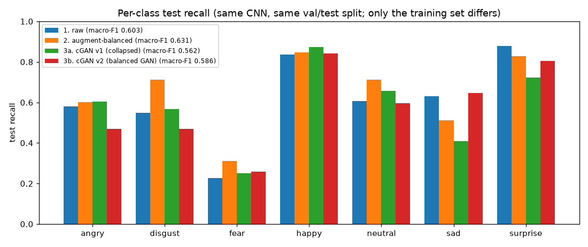
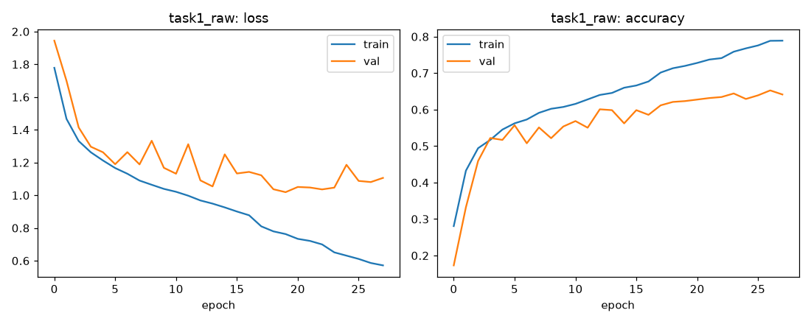
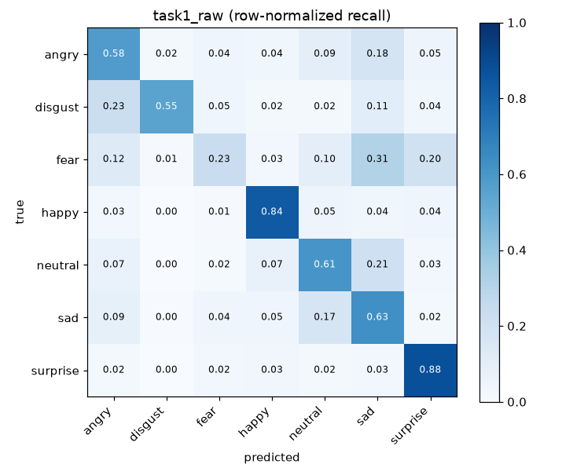
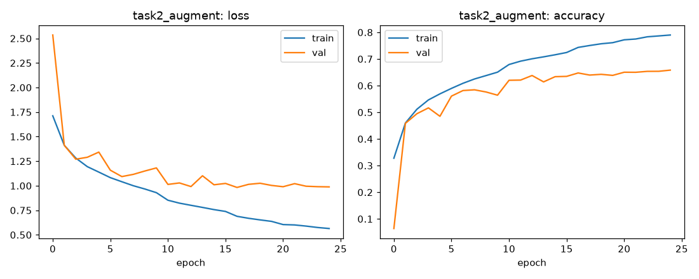
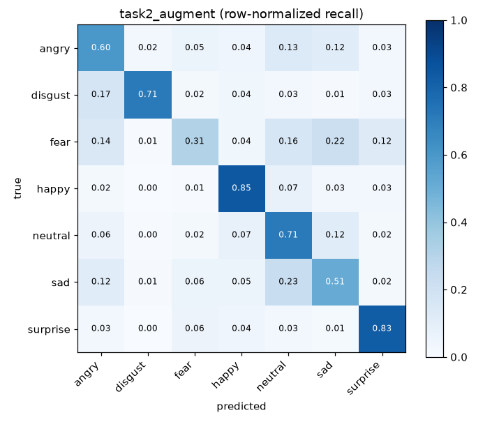
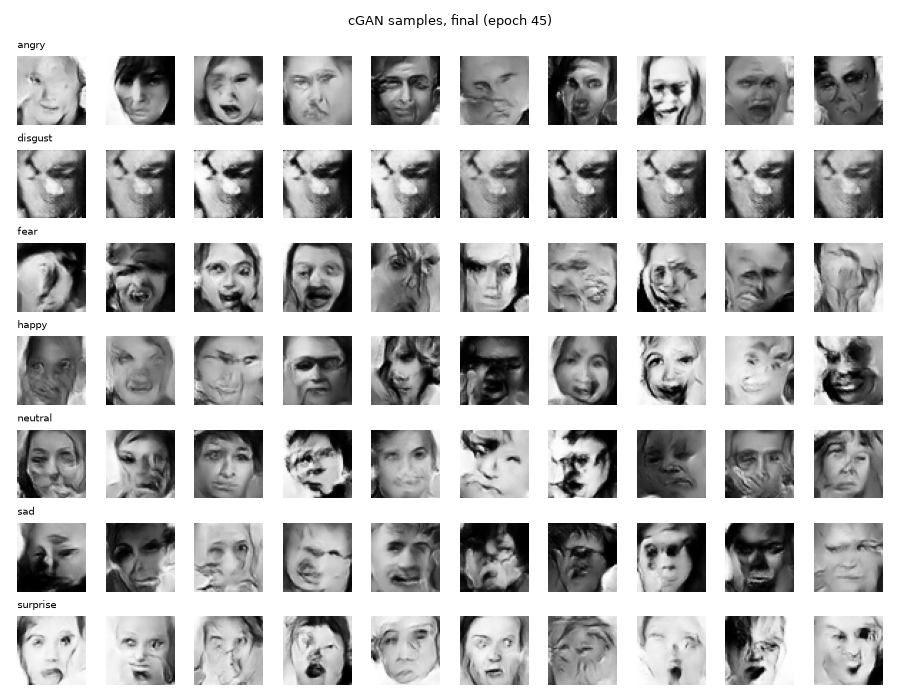
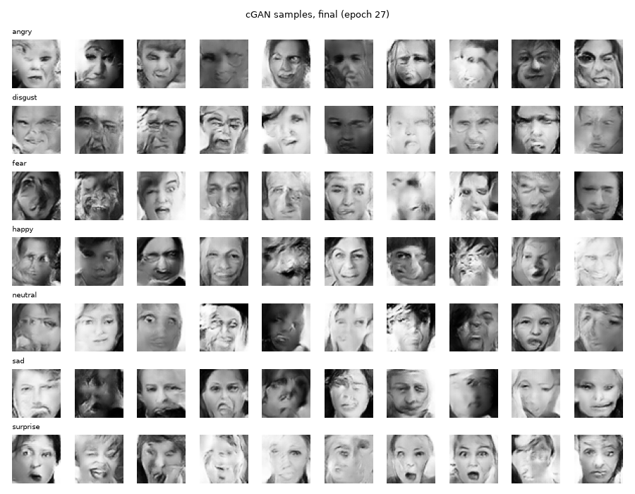
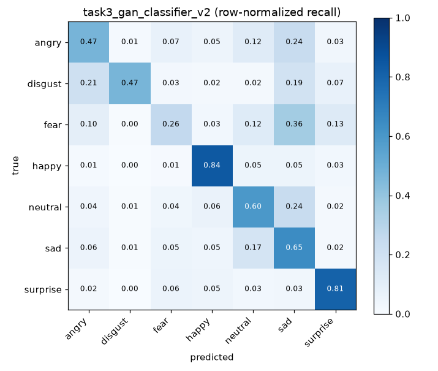

# FER2013 情緒分類：原始資料 vs 影像增強 vs GAN 生成資料（Keras）

課程作業「訓練情緒分類器」的完整程式、實驗紀錄與心得。資料集為 Kaggle 上的
[FER2013](https://www.kaggle.com/datasets/msambare/fer2013)（48×48 灰階人臉，7 種情緒）。

作業要求三個任務：

1. 用原始資料、不處理，直接訓練一個情緒分類模型
2. 用影像增強讓各類別數量比較平均，再訓練一個情緒分類模型
3. 訓練一個 GAN，用它生成資料後，再訓練一個情緒分類模型

## 結果總覽

四個模型使用**完全相同**的 CNN、超參數、隨機種子、驗證集與測試集，唯一不同的是「訓練集」。
測試集（7,178 張，從未參與訓練或挑模型）上的結果：

| 實驗 | 訓練集內容 | 測試準確率 | 測試 macro-F1 | disgust 召回率 | fear 召回率 |
|---|---|---|---|---|---|
| 任務 1：原始資料 | 24,403 張真圖 | 64.04% | 0.603 | 0.549 | 0.228 |
| **任務 2：影像增強平衡** | 真圖 + 18,528 張增強圖（每類 6,133） | **65.20%** | **0.631** | **0.712** | **0.311** |
| 任務 3a：GAN v1 平衡 | 真圖 + 18,528 張 GAN 圖（disgust 崩塌） | 60.82% | 0.562 | 0.568 | 0.251 |
| 任務 3b：GAN v2 平衡 | 真圖 + 18,528 張 GAN 圖（修正崩塌） | 62.26% | 0.586 | 0.469 | 0.260 |

七個類別的完整召回率見 [`results/summary.md`](results/summary.md)，每個實驗的詳細指標見 `results/<實驗>/metrics.json`。



一句話結論：**影像增強平衡（任務 2）最有效，macro-F1 從 0.603 提升到 0.631；用 GAN 生成圖補資料（任務 3）在這次的訓練預算下反而變差。修正 GAN 的模式崩塌後有改善（0.562 → 0.586），但仍輸給不處理的基準**

---

## 1. 環境與重現方式

| 項目 | 版本 |
|---|---|
| 硬體 | Apple M5（Keras 透過 PyTorch 後端使用 Apple GPU / MPS） |
| Python | 3.12 |
| Keras | 3.15.1（後端 `torch` 2.14.1） |
| 其他 | numpy、scikit-learn、matplotlib、pillow，見 `requirements.txt` |

```bash
uv venv .venv --python 3.12
uv pip install --python .venv/bin/python -r requirements.txt

# 下載資料（需要 Kaggle API 帳號；資料不放在本倉庫）
kaggle datasets download -d msambare/fer2013 -p data/raw
unzip -q data/raw/fer2013.zip -d data/extracted

export KERAS_BACKEND=torch
.venv/bin/python task1_baseline.py                 # 任務 1
.venv/bin/python task2_augment.py                  # 任務 2
.venv/bin/python task3_gan.py                      # 任務 3：GAN v1（一般抽樣）
.venv/bin/python task3_gan.py --balanced           # 任務 3：GAN v2（各類別均衡抽樣）
.venv/bin/python task3_classifier.py --generator task3_generator.keras    --task-name task3_gan_classifier_v1
.venv/bin/python task3_classifier.py --generator task3_generator_v2.keras --task-name task3_gan_classifier_v2
.venv/bin/python analyze_gan_memorization.py       # GAN 是否在「背圖」的檢查
.venv/bin/python make_summary.py                   # 產生比較表與比較圖
```

下載的 `fer2013.zip` SHA-256 為
`9f3422c7a45b676c2965ef4fc5f3099932aa98fd13eaaa2c254f620a9894a6e9`，可用來確認拿到的是同一份資料。

| 檔案 | 用途 |
|---|---|
| `common.py` | 共用：讀資料、切驗證集、CNN 架構、訓練與評估、畫圖 |
| `task1_baseline.py` | 任務 1 |
| `task2_augment.py` | 任務 2：影像增強過採樣 |
| `task3_gan.py` | 任務 3：條件式 DCGAN（cGAN）訓練 |
| `task3_classifier.py` | 任務 3：用 GAN 補資料後訓練分類器，並檢查生成圖品質 |
| `analyze_gan_memorization.py` | 檢查生成圖是否只是複製訓練圖 |
| `make_summary.py` | 彙整四個實驗 |
| `results/` | 每個實驗的指標 JSON、學習曲線、混淆矩陣、GAN 樣本圖 |
| `logs/` | 每次訓練的完整輸出 |

## 2. 資料與實驗設計

### 2.1 資料分布（非常不平均）

Kaggle 這個版本只有 `train/`（28,709 張）與 `test/`（7,178 張）。我從 `train/` 依類別比例、
固定種子（42）分層抽出 15% 當**驗證集**，其餘當訓練集：

| | angry | disgust | fear | happy | neutral | sad | surprise | 合計 |
|---|---|---|---|---|---|---|---|---|
| 訓練 | 3,396 | **371** | 3,482 | **6,133** | 4,220 | 4,106 | 2,695 | 24,403 |
| 驗證 | 599 | 65 | 615 | 1,082 | 745 | 724 | 476 | 4,306 |
| 測試 | 958 | 111 | 1,024 | 1,774 | 1,233 | 1,247 | 831 | 7,178 |

happy 和 disgust 差了 16.5 倍。這是任務 2、3 想解決的問題。

### 2.2 讓比較公平的規則

這些規則是在寫模型程式**之前**就決定好的：

- **同一個 CNN**：VGG 風格，4 個卷積區塊（32→64→128→256 個濾鏡，每塊兩層 3×3 卷積 + BatchNorm + ReLU，
  接 MaxPool 與 Dropout 0.25），再接 GlobalAveragePooling、Dense(256)、Dropout 0.5、softmax(7)。共 1,242,151 個參數。
- **同一組訓練設定**：Adam lr=1e-3、batch 128、最多 50 epochs；驗證損失 3 個 epoch 沒進步就把學習率減半，
  8 個 epoch 沒進步就提早停止，並還原驗證損失最低時的權重；隨機種子固定為 42。
- **驗證集與測試集永遠只有真實影像**：不做增強、不放生成圖。先切好驗證集，才對訓練集做平衡，
  避免同一張照片的增強版本同時出現在訓練與驗證集。
- **測試集只在最後評估一次**：挑 epoch 只看驗證集。
- **不只看準確率**：資料不平衡時，模型全猜 happy 也有 25% 準確率，所以同時報告 **macro-F1**
  （七類 F1 的平均，每類權重相同）、各類別召回率與混淆矩陣。

## 3. 任務 1：原始資料直接訓練

**步驟**

1. 讀入 48×48 灰階 JPG，轉成 uint8 陣列。
2. 唯一的處理是把像素除以 255 縮放到 [0, 1]，這是神經網路輸入必要的格式轉換。
   不做影像增強、不重新取樣、不加 class weight。
3. 用上述 CNN 與訓練設定訓練。

**結果**：測試準確率 **64.04%**，macro-F1 **0.603**（第 20 個 epoch 最佳，第 28 個 epoch 提早停止）。




- 訓練準確率持續上升到約 79%，驗證準確率停在 62% 左右：**模型開始過擬合**，提早停止有發揮作用。
- **fear 最難**（召回率 0.23）：1,024 張 fear 測試圖中，322 張被判成 sad、202 張被判成 surprise，只有 233 張判對。這幾類表情本來就相似（張嘴、皺眉），FER2013 人工標註的一致率也不高。
- disgust 只有 371 張訓練圖，召回率 0.55，比預期好，但這個類別只有 111 張測試圖，數字的不確定性較大。

## 4. 任務 2：影像增強讓資料平均後訓練

**步驟**

1. 目標：每個類別都補到和最多的類別（happy，6,133 張）一樣多。訓練集從 24,403 張變成 42,931 張。
2. 原始影像全部保留不動。每類不足的張數，從該類原圖中隨機挑一張（可重複挑），套上隨機增強後當作新圖。
   disgust 從 371 張補到 6,133 張，平均每張原圖會產生約 15 個變形版本。
3. 增強用 Keras 的前處理層（`keras.layers.Random*`），刻意選擇**不會改變表情意義**的溫和變換：
   - `RandomFlip("horizontal")`：左右翻轉（表情左右翻轉後意義不變；上下翻轉就不合理，所以不用）
   - `RandomRotation(0.04)`：約 ±15° 旋轉
   - `RandomTranslation(0.08)`、`RandomZoom(±10%)`：模擬不同的人臉裁切位置與大小
   - `RandomContrast(0.2)`、`RandomBrightness(0.15)`：模擬不同光線
4. 用平衡後的訓練集，以和任務 1 完全相同的 CNN 與設定訓練。

**結果**：測試準確率 **65.20%**（+1.2），macro-F1 **0.631**（+0.029）。




- 少數類別明顯變好：**disgust 召回率 0.55 → 0.71**，fear 0.23 → 0.31，neutral 0.61 → 0.71。
- 但 **sad 從 0.63 掉到 0.51**。原本 sad 是大類別，模型偏好猜它；類別平衡後，模型不再那麼常猜 sad，
  更多 sad 被判成 neutral（209 → 290 張）或 angry（106 → 144 張）。這是平衡資料常見的取捨：少數類別變好，原本受惠於數量優勢的類別會變差。
- 整體準確率只小幅上升，但 macro-F1 上升較多。這正好說明在不平衡資料上要看 macro-F1。

## 5. 任務 3：用 GAN 生成資料後訓練

### 5.1 GAN 架構：條件式 DCGAN（cGAN）

一般 GAN 只能生成「一張臉」，無法指定情緒。要補某一類的資料，GAN 必須能依指令生成指定的情緒，
所以使用**條件式 GAN**：把情緒標籤同時餵給生成器與判別器。

- **生成器 G**：輸入 128 維隨機雜訊 z，加上情緒標籤（Embedding 成 50 維）→ Dense 成 6×6×256 →
  3 層轉置卷積放大（6→12→24→48）→ tanh 輸出一張 48×48 灰階臉（像素範圍 [-1, 1]）。約 2.37M 參數。
- **判別器 D**：輸入一張臉，加上一張由標籤轉成的 48×48「標籤圖」，兩者疊在一起 → 3 層步長 2 的卷積
  （48→24→12→6）→ 輸出一個數字，代表「這是不是一張真的、且符合這個情緒的臉」。約 0.78M 參數。
- **訓練方式**：兩者輪流更新。D 學著分辨真圖與假圖；G 學著讓 D 把假圖判成真的。
  使用 Adam(2e-4, β1=0.5)，真圖標籤用 0.9（label smoothing，避免 D 過度自信）。
  程式依照 Keras 官方「PyTorch 後端自訂 `train_step`」的寫法實作（`task3_gan.py`）。
- 只用訓練集訓練 GAN，驗證集與測試集不參與。
- 時間預算：每個 GAN 最多訓練 70 分鐘。

### 5.2 第一次嘗試（v1）：disgust 發生「模式崩塌」

v1 用一般方式（整個訓練集隨機打亂）訓練了 45 個 epoch（約 8,600 步）。下圖每列是一種情緒，
每欄用不同的隨機雜訊：



其他情緒雖然模糊、五官常變形，但看得出是不同的臉。**disgust 那一列十張幾乎一模一樣**，
不管輸入什麼雜訊都輸出同一張圖，這就是 **mode collapse（模式崩塌）**。

**原因分析**：一個 batch 128 張圖裡，真的 disgust 平均只有 128 × 371 / 24,403 ≈ **2 張**；
但生成器被要求生成的假圖標籤是均勻抽的，平均有 128 / 7 ≈ **18 張**標成 disgust。
判別器很快就學到「標籤是 disgust 的圖幾乎都是假的」，生成器在 disgust 上拿不到有用的學習訊號，
只好找到一張「勉強能騙過 D」的圖，然後一直輸出它。

如果直接把 v1 的生成圖拿來補資料（任務 3a），等於把 **5,762 張幾乎相同的圖**標成 disgust 塞進訓練集。

### 5.3 第二次嘗試（v2）：每個類別均衡抽樣

v2 **只改一件事**：訓練 GAN 時，每個類別的真實影像都重複抽到 6,133 張，讓每個 batch 裡七種情緒的真圖數量差不多。
其他架構與設定完全相同，所以兩版差異可以歸因於這個改變。v2 在相同的 70 分鐘內跑了 27 個 epoch（約 9,000 步，和 v1 的步數相近）。



disgust 不再崩塌，每張都不同了。生成過程可以從 `results/task3_gan*/samples_epoch*.png` 看到各階段的變化。

### 5.4 生成圖品質檢查

肉眼看圖很主觀，所以另外做了三個量化檢查：

| 檢查 | 做法 | v1 | v2 | 真實照片 |
|---|---|---|---|---|
| **多樣性**（disgust） | 隨機取 300 張，兩兩之間的平均像素差。接近 0 代表全部長一樣 | **0.073** | 0.262 | 0.269 |
| **標籤正確性**（disgust） | 用任務 1 的模型（只看過真實照片）去辨識生成圖，判成 disgust 的比例 | **0.0%** | 28.3% | 55%（任務 1 在真實測試集的召回率） |
| **是否在背圖**（disgust） | 每張生成圖與「最像的那張同類訓練圖」的平均像素差 | 0.179 | 0.146 | 0.085（驗證集真圖） |

各類別完整數字在 `results/task3_gan_classifier_v*/balance_counts.json` 與 `results/task3_gan_memorization.json`。

- **多樣性**：v1 的 disgust 只有真實照片的四分之一，量化證實了崩塌；v2 已接近真實照片。
- **標籤正確性**：v1 的 disgust 生成圖**沒有一張**被判成 disgust；v2 提升到 28%。
  其他類別約 10%（fear）到 49%（surprise）。生成圖確實帶有一些表情特徵，但遠不如真實照片清楚。
- **背圖檢查**：生成圖與最像的訓練圖之間，差異比「一張新的真實照片」還大，所以 GAN 不是在複製訓練圖。
  另外發現真實的 disgust 驗證圖與訓練圖之間的距離特別小（0.085），表示 **FER2013 本身含有近乎重複的照片**。
  這也提醒我們，這個資料集的驗證/測試分數可能有一點偏樂觀。

### 5.5 用 GAN 補資料後訓練分類器

做法與任務 2 相同，每類補到 6,133 張，差別是補進來的是 GAN 生成圖而不是增強圖。
例如 disgust 是 371 張真圖加 5,762 張生成圖，**94% 是假的**。

| | 測試準確率 | macro-F1 | disgust 召回率 |
|---|---|---|---|
| 任務 1（原始） | 64.04% | 0.603 | 0.55 |
| 任務 2（影像增強） | 65.20% | 0.631 | 0.71 |
| 任務 3a（GAN v1，崩塌） | 60.82% | 0.562 | 0.57 |
| 任務 3b（GAN v2，均衡抽樣） | 62.26% | 0.586 | 0.47 |



- **v1 比基準差**（macro-F1 0.603 → 0.562）。v1 的 disgust 召回率看似持平（0.57），但模型把 167 張測試圖判成 disgust
  （基準只有 106 張），誤判變多，disgust 的 F1 從 0.56 掉到 0.45。sad 召回率也從 0.63 掉到 0.41。
  大量品質差的假圖等於在訓練集加入雜訊。
- **v2 比 v1 好，但仍比基準差**（macro-F1 0.586）。最意外的是 **disgust 召回率反而降到 0.47**，
  而且模型只把 87 張測試圖判成 disgust，比基準更少。
  我的解讀是：訓練集裡的 disgust 有 94% 是 GAN 圖，分類器學到的「disgust 長相」很大一部分是
  **GAN 圖特有的模糊與變形**，而不是真實的厭惡表情。測試集全是真實照片，沒有這些痕跡，所以真的 disgust 反而認不出來。
  第 5.4 節的檢查也支持這個解讀：連任務 1 的模型都只把 28% 的 v2 disgust 生成圖認成 disgust，代表表情特徵並不清楚。
- **影像增強為什麼贏 GAN**：增強圖是「真照片的小變形」，表情本身 100% 是真的，標籤也一定正確；
  GAN 圖是「模型想像的臉」，在品質不夠好時，表情可能不像、標籤可能不對，還帶有生成痕跡。
  在資料這麼少（disgust 只有 371 張）的情況下，GAN 本身也學不好這一類，等於要用很少的資料去訓練一個更難訓練的模型。

## 6. 心得

1. **先定好公平比較的規則，再開始做實驗。** 三個任務只改訓練集，其他全部固定。驗證集與測試集只有真實照片，
   而且先切好驗證集才做平衡。否則同一張照片的增強版本可能同時出現在訓練與驗證集，分數會虛高，三個結果也無法比較。
2. **不平衡資料不能只看準確率。** 任務 2 的準確率只多 1.2 個百分點，但 disgust 召回率從 0.55 跳到 0.71。
   反過來，任務 3a 的 disgust 召回率看起來沒變，F1 卻掉很多，因為誤判變多了。要同時看召回率、F1 和混淆矩陣才看得清楚。
3. **平衡資料是取捨，不是免費的提升。** 少數類別變好時，原本靠數量優勢的類別（sad）會變差。
4. **GAN 很難訓練，而且「看起來能跑」不代表「有用」。** 損失曲線看起來正常，但打開樣本圖才發現 disgust 十張都一樣。
   每隔幾個 epoch 存一張固定雜訊的樣本圖非常重要。
5. **找出失敗的原因，比換一個方法重試更有價值。** 算出「每個 batch 只有 2 張真的 disgust，卻有 18 張假的」之後，
   修正方法就很明確（均衡抽樣），而且 v2 只改這一件事，所以能確定是它解決了崩塌。
6. **用量化指標檢查生成品質，而不是只靠肉眼。** 多樣性、「基準模型認不認得出來」、「是不是在背圖」三個檢查，
   都是用已有的工具就能做的簡單計算，卻讓「GAN 圖品質不夠」從主觀印象變成可驗證的數字。
   背圖檢查還意外發現 FER2013 本身有近乎重複的照片。
7. **負面結果也是結果。** 任務 3 沒有贏過基準，但我照實記錄，並分析原因（生成痕跡被分類器學成類別特徵），
   沒有為了讓 GAN 看起來有效而一直調參數或挑結果。
8. **從之前的 Kaggle 競賽專案帶來的習慣**：固定隨機種子、記錄資料檔的 SHA-256、每個實驗都存下設定與指標的 JSON、
   保留失敗實驗（GAN v1）的證據、限制每個實驗的時間預算、用獨立的虛擬環境避免影響其他工作。
   這些習慣讓這份報告裡的每個數字都能追溯到對應的檔案並重現。

## 7. 限制

- 每個設定只用一個隨機種子訓練一次。macro-F1 相差 0.01～0.02 時，可能落在不同種子的正常波動範圍內。
  disgust 只有 111 張測試圖，它的召回率每變動 0.01 只代表約 1 張圖。
- GAN 只訓練了 70 分鐘（v1 45 epochs、v2 27 epochs），生成品質仍有提升空間。
  更長的訓練、更好的架構（例如 WGAN-GP、StyleGAN 系列）或擴散模型，可能讓任務 3 得到不同結論。
- 驗證集是從 `train/` 切出來的，而 FER2013 有近乎重複的照片，所以驗證與測試分數可能偏樂觀。

## 8. 本倉庫刻意不包含的東西

| 不包含 | 原因 |
|---|---|
| FER2013 原始影像與 zip（`data/`） | 資料集版權屬原作者，請從 Kaggle 下載；用上方 SHA-256 確認版本 |
| 含真實人臉的範例圖（任務 2 的增強前後對照圖） | 圖中是資料集裡的真實人物照片，不重新散布 |
| 訓練好的模型權重（`models/*.keras`） | 由資料訓練而來、檔案大，可用腳本重新產生 |
| 虛擬環境（`.venv/`）、快取（`*.npz`） | 可由 `requirements.txt` 與腳本重建 |

公開的樣本圖都是 GAN 生成的影像，不是真人照片；第 5.4 節的檢查也顯示它們不是訓練照片的複製品。

## 授權

程式碼以 MIT License 釋出（見 `LICENSE`）。FER2013 資料集不在此授權範圍內。

本作業在 AI（Claude）協助下完成。實驗設計、程式與報告內容都經過逐項檢查與理解。
